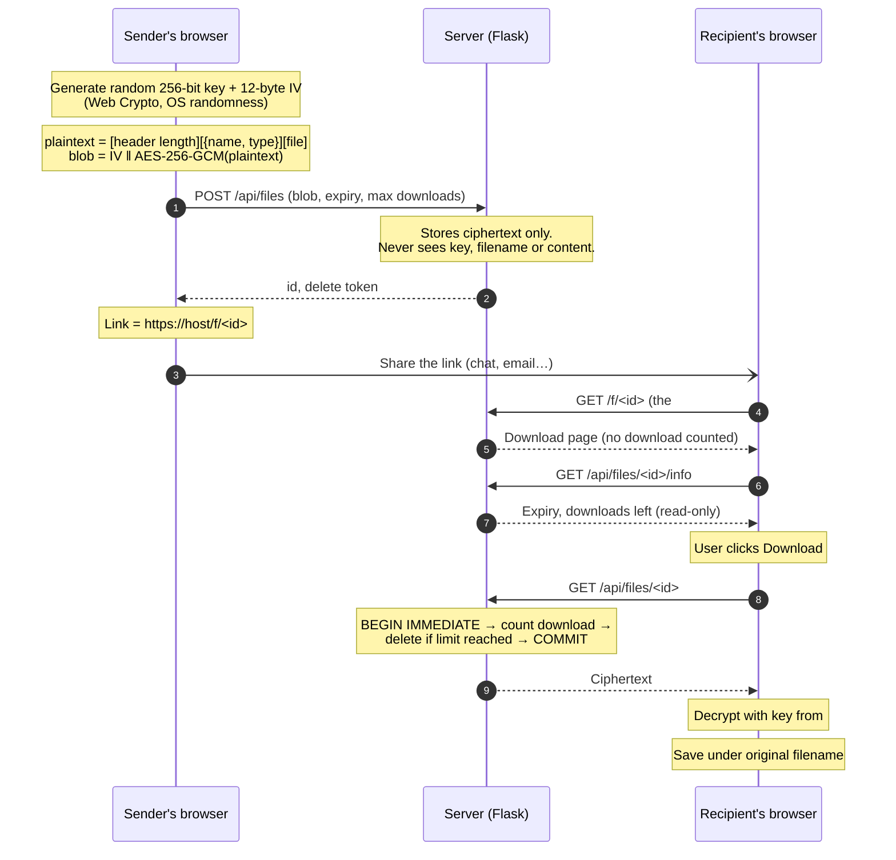

# secure-share

[](https://github.com/Romankdk/secure-share/actions/workflows/tests.yml)

End-to-end encrypted, self-destructing file sharing.

Files are encrypted **in your browser** before they're uploaded, and decrypted in the recipient's
browser. The key travels in the link's `#fragment`, which browsers never send to a server, so the
server stores only ciphertext and **cannot read the files it holds**, even if it's compromised or
subpoenaed. Links expire after 1 hour, 1 day or 7 days, or after 1 to 10 downloads, whichever
comes first, and then the ciphertext is deleted.

## How it works



### What the server stores

| Stored | Not stored (never reaches the server) |
|---|---|
| Ciphertext (`IV ‖ ciphertext ‖ GCM tag`) | The key |
| Ciphertext size | The filename and MIME type (encrypted inside the blob) |
| Expiry time, download limit and count | The file contents |
| SHA-256 of the delete token | The delete token itself |

## Threat model

### What it protects against

| Threat | Protection |
|---|---|
| **The server (or whoever controls it) reading files**: a breach, a rogue admin, a backup leak, a legal demand | Encryption and decryption happen only in browsers; the key is in the URL fragment, which is never sent in HTTP requests, `Referer` headers or server logs. |
| **Tampering with stored files** | AES-GCM is authenticated: changing any byte of the ciphertext, IV or tag makes decryption fail instead of producing a modified file. |
| **Guessing links to find other people's files** | IDs are 128 random bits (`secrets.token_urlsafe(16)`); keys are 256 random bits. |
| **Two people racing to grab a one-time file** | The download runs inside `BEGIN IMMEDIATE`, so concurrent requests are serialised; exactly one succeeds (tested with 8 simultaneous requests). |
| **Chat-app link previews burning one-time links** | Opening `/f/<id>` only serves a page. A download is only counted when the user clicks the button. `HEAD` requests to the download API (link checkers, proxies) get 405 instead of silently using up a download. |
| **Path traversal via the file ID** | IDs must match `^[A-Za-z0-9_-]{22}$` before they're used anywhere near the filesystem. |
| **Deleting someone else's file** | Deletion requires the delete token, stored only as a SHA-256 hash and compared in constant time (`hmac.compare_digest`). |
| **Cross-site scripting** | Strict CSP with no inline scripts or styles; the UI only ever uses `textContent`, never `innerHTML`. Decrypted files are always saved as `application/octet-stream`, so an uploader can't make one render as HTML in this site's origin. |
| **Clickjacking, MIME sniffing, referrer leaks, caching** | `frame-ancestors 'none'` + `X-Frame-Options: DENY`, `nosniff`, `Referrer-Policy: no-referrer`, `Cache-Control: no-store`. |
| **Malicious filenames** (`../../`, right-to-left override tricks) | Names from the decrypted header are sanitised before saving. |
| **Huge uploads** | 25 MB limit enforced before the request body is read (HTTP 413). |
| **Flooding the server** | Per visitor: 10 uploads per hour and 100 MB per day (HTTP 429), so no one visitor can use up the shared 300 MB storage cap (HTTP 503 when full). IPv6 visitors are counted per /64, since one customer usually controls a whole /64. Visitors are tracked only as an HMAC of their IP (key kept in `instance/rate_limit.key`, so limits survive restarts and are shared across worker processes), never the raw IP, and entries are deleted after 24 hours. |
| **Other websites making their visitors upload here** (to spread uploads across many IPs) | Uploads must be same-origin: `Sec-Fetch-Site` must say so when present, and the custom `X-Requested-With` header must be set, which browsers only send cross-site after a CORS preflight this server never approves. |
| **HTTPS being stripped** | `Strict-Transport-Security` on HTTPS responses, so browsers refuse plain HTTP afterwards; otherwise an attacker on the network could serve key-stealing JavaScript. |

### Limits (what it does not protect against)

- **It trusts the server to deliver honest JavaScript.** All crypto runs in code the server sends.
  A compromised server could serve modified JS that leaks keys. This is the fundamental limit of
  any browser-based end-to-end encryption; native apps or browser extensions with pinned code avoid it.
- **Anyone who gets the link can open the file.** The link *is* the key. If it leaks (a forwarded
  message, a screenshot, browser history, a compromised chat account), the file is exposed until
  it expires or is downloaded. There's no password or recipient identity check.
- **A wrong key still uses up a download.** The server never sees keys, so it can't tell a good key
  from a bad one. The page rejects obviously malformed keys before downloading to limit this.
- **Metadata is visible to the server:** file size (roughly), upload and download times, and IP addresses.
- **Files are held in memory** (up to 25 MB) during upload, download, encryption and decryption,
  which caps the practical file size.
- **Rate limiting is basic.** It's per IP (per /64 for IPv6), so many visitors behind one network
  share a limit, and someone controlling many IPs can exceed it. Downloads and `/info` aren't rate
  limited (IDs are unguessable).
- **The first visit isn't protected by HSTS** on a `*.pythonanywhere.com` subdomain (no preloading
  possible there). A custom domain on the HSTS preload list would close that gap.
- **It must be served over HTTPS** in production: browsers only expose Web Crypto on secure origins
  (`localhost` is the exception).
- **Deletion is best effort.** Files are removed from disk, but not securely overwritten; SSDs,
  filesystem snapshots or backups may retain ciphertext. Because it's encrypted, that is only a
  risk if the key also leaks.

## Run it

Requires Python 3.9+.

```bash
git clone https://github.com/Romankdk/secure-share.git
cd secure-share
python3 -m venv .venv
source .venv/bin/activate          # Windows: .venv\Scripts\activate
pip install -r requirements.txt
flask --app secure_share run
```

Open http://127.0.0.1:5000. (Use `localhost`/`127.0.0.1` or HTTPS: browsers disable Web Crypto on plain-HTTP sites.)

Data is kept in `instance/` (SQLite database, ciphertext blobs, and the rate-limit key). Expired
links stop working the moment they expire. Their ciphertext is deleted from disk by a cleanup that
site traffic triggers (at most once a minute), or on demand with:

```bash
flask --app secure_share purge
```

## Deploy for free on PythonAnywhere

PythonAnywhere's free tier runs Flask apps with HTTPS and persistent storage, so links work from anywhere.
Replace `USERNAME` below with your PythonAnywhere username.

1. Create a free **Beginner** account at [pythonanywhere.com](https://www.pythonanywhere.com).
2. Open **Consoles → Bash** and run:
   ```bash
   git clone https://github.com/Romankdk/secure-share.git
   cd secure-share
   python3.11 -m venv .venv
   source .venv/bin/activate
   pip install -r requirements.txt
   ```
3. Open the **Web** tab → **Add a new web app** → **Manual configuration** (not the "Flask" option) → **Python 3.11**.
4. Still on the **Web** tab:
   - **Virtualenv:** enter `/home/USERNAME/secure-share/.venv`
   - **Code → WSGI configuration file:** click the link, delete everything in the file, paste this and save:
     ```python
     import sys

     path = "/home/USERNAME/secure-share"
     if path not in sys.path:
         sys.path.insert(0, path)

     from secure_share import create_app

     application = create_app({
         # PythonAnywhere puts one proxy in front of the app; this lets the rate limit see real
         # visitor IPs and lets the app know the connection was HTTPS (for HSTS).
         "TRUSTED_PROXIES": 1,
         # Refuse requests for any other hostname.
         "TRUSTED_HOSTS": ["USERNAME.pythonanywhere.com"],
     })
     ```
   - **Security:** turn on **Force HTTPS**.
5. Click the green **Reload** button and open `https://USERNAME.pythonanywhere.com`.
6. **Check it's locked down.** From your own computer's terminal:
   ```bash
   curl -sI https://USERNAME.pythonanywhere.com/ | grep -iE "strict-transport|content-security"
   ```
   Both headers must appear. If `Strict-Transport-Security` is missing, the proxy isn't reporting
   HTTPS and `TRUSTED_PROXIES` needs checking. Then upload a test file in the browser, open its link
   in a private window, and download it.

Don't add a scheduled task that runs `flask purge`: PythonAnywhere runs tasks on different machines
from the website, and SQLite shouldn't be written from two machines over network storage. Site
traffic already triggers cleanup.

To update after pushing changes to GitHub: in a Bash console run `cd ~/secure-share && git pull`, then
click **Reload** on the Web tab. Free web apps must be renewed every 3 months with one click on the Web tab.

## Tests

```bash
pip install -r requirements-dev.txt   # adds pytest
python -m pytest -v                    # server: 78 tests
node --test tests/crypto.test.mjs      # browser crypto (Node 20+): 7 tests
```

The server tests cover upload/download roundtrips, one-time and multi-download limits, expiry
(with an injectable fake clock instead of sleeping), concurrent downloads of a one-time link,
`/info` and the download page not consuming downloads, invalid and path-traversal IDs, delete
tokens, size limits, input validation, rate limits (per visitor, per /64, across restarts and
workers), cross-site upload rejection, the exact deployment config behind a proxy, cleanup
resilience, and security headers. The crypto tests cover roundtrips,
fresh keys and IVs, wrong keys, tampering with the IV, ciphertext and tag, and filename sanitisation.

## Project layout

```
secure_share/
  __init__.py        app factory, config, security headers, JSON errors
  db.py              SQLite schema, connection handling, purge + `flask purge`
  api.py             upload, info, download (atomic), delete
  pages.py           HTML pages (never consume downloads)
  static/crypto.js   all encryption and decryption (Web Crypto, AES-256-GCM)
  static/upload.js   upload page logic
  static/download.js download page logic
  templates/         HTML (no inline scripts or styles)
tests/
  test_app.py        pytest suite for the server
  crypto.test.mjs    Node tests for crypto.js
```

## What I learned

_To be written._

## License

MIT. See [LICENSE](LICENSE).
